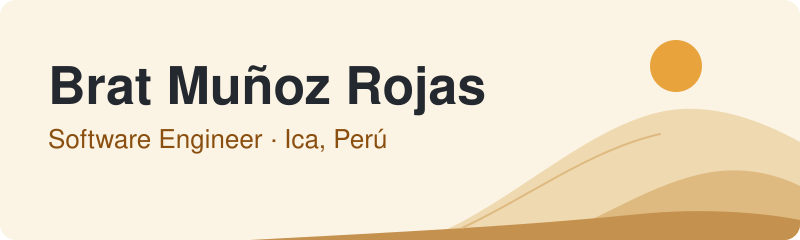

# Hola, soy Brat

<picture>
  <source media="(prefers-color-scheme: dark)" srcset="./assets/banner-dark.svg">
  
</picture>

<p align="center">
  <b>Desarrollo software para web, móvil y escritorio, y aprendo algo nuevo en cada proyecto.</b>
</p>

<p align="center">
  <a href="https://www.linkedin.com/in/bmrds">LinkedIn</a>
  &nbsp; → &nbsp;
  <a href="mailto:bratbrm@gmail.com">bratbrm@gmail.com</a>
</p>

---

## Sobre mí

Terminé la carrera de desarrollo de software. Me gusta explorar nuevas tecnologías y convertirlas en soluciones que la gente pueda usar.

Hoy dedico la mayor parte de mi tiempo a:

- Desarrollar soluciones de software
- Explorar nuevas tecnologías
- Compartir trucos rápidos y asesorar a quien lo necesite
- Estudiar inglés

---

## Cómo trabajo

Para mí, programar es solo una parte. Primero hay que entender qué problema se quiere resolver.

**Problema → Idea → Desarrollo → Pruebas → Entrega → Mejora**

---

## Qué me interesa

```text
Desarrollo web
Aplicaciones móviles
Software de escritorio
Bases de datos
Diseño de interfaces
Nuevas tecnologías
```

---

## Tecnologías

| Área | Stack |
| :-- | :-- |
| **Web** |  |
| **Móvil** |  |
| **Escritorio** |  |
| **Bases de datos** |  |
| **Herramientas** |  |

---

## GitHub

<p align="center">
  
</p>

<p align="center">
  <picture>
    <source media="(prefers-color-scheme: dark)" srcset="https://streak-stats.demolab.com/?user=Bratbrm&locale=es&hide_border=true&disable_animations=true&background=161b22&ring=f2c078&fire=f2c078&currStreakLabel=f2c078&stroke=3a3024&currStreakNum=f0f6fc&sideNums=f0f6fc&sideLabels=f0f6fc&dates=c9d1d9">
    
  </picture>
</p>

---

## Conectemos

Si tienes una idea, buscas a alguien que desarrolle software o necesitas asesoramiento, escríbeme. Intentaré responder lo antes posible.

<p>
  <a href="https://www.linkedin.com/in/bmrds"></a>
  <a href="mailto:bratbrm@gmail.com"></a>
</p>

---

> Explora algo nuevo.
>
> Constrúyelo.
>
> Aprende de lo que salga.
>
> Repite.

<p align="center">
  <b>Ahora mismo → estudiando inglés y explorando nuevas tecnologías</b>
</p>
